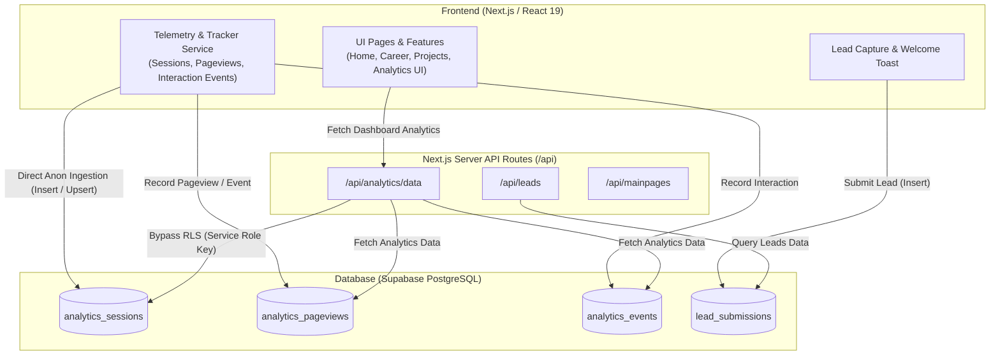

# Project Overview: AI Portfolio

A modern, interactive developer portfolio and analytics engine built with **Next.js (App Router)**, **React 19**, **Tailwind CSS**, and **Supabase**. The application features rich UI micro-interactions, dynamic content discovery, lead acquisition flows, AI/interactive showcase components, and a custom telemetry & visitor tracking system.

---

## 🌟 Key Features

### 1. 💼 Interactive Career & Project Showcase
- **Dynamic Timeline & Experience**: Filterable tech stacks, career timeline items, role highlights, and project achievements.
- **Rich Media & Modal Views**: In-depth project cards with embedded previews, tech tags, live links, and modal details.
- **Future Roadmap & Goals**: Showcase of upcoming projects, tech milestones, and learning trajectories.

### 2. ⚡ Custom Real-Time Telemetry & Analytics
- **Session Tracking**: Automatic tracking of visitor sessions, device types, screen resolutions, languages, operating systems, and IP-based geo-location metadata.
- **Pageview & Engagement Metrics**: Tracks page navigation, scroll depth percentage, and total time spent per page.
- **Behavioral Event Capture**: Monitors user interactions including text selections, UI element clicks, feature interactions, and contextual selection events.
- **Analytics Dashboard**: Interactive dashboard displaying session metrics, visitor demographics, event logs, lead submissions, and engagement analytics.

### 3. 🎯 Lead Capture & Personalization Flow
- **Lead Submission Form**: Modal/Toast capturing visitor contact details (`Name`, `Email`, `Reason for Contact`, `Source`).
- **Visitor Contextual Recognition**: Integrates lead details with visitor cookie tracking to personalize greetings (`LeadWelcomeToast`) upon return visits.
- **Row-Level Secured Data Ingestion**: Direct data ingestion via client-side Supabase client with RLS-protected write-only access for anonymous users.

### 4. 🎨 Modern UI/UX Architecture
- **Responsive Navigation**: Adaptive topbar with custom navigation links, quick actions, and mobile menu transitions.
- **Interactive Floating Bar / Chatbar**: Quick access to contact options, social links, resume downloads, and interactive prompts.
- **Smooth Animations**: Animated transitions powered by `framer-motion` and Tailwind animation utilities.

---

## 🏗 System Architecture

---

## 🗄 Database Schema (Supabase PostgreSQL)

The project leverages four primary tables configured with **Row Level Security (RLS)**:

| Table | Key Fields | Description | Security / RLS Policy |
| :--- | :--- | :--- | :--- |
| **`analytics_sessions`** | `id`, `cookie_id`, `ip_address`, `country`, `city`, `device_type`, `browser`, `os`, `visitor_name`, `visitor_email` | Stores unique visitor sessions and user-agent / geo metadata. | Anon: INSERT & UPDATE permitted. SELECT blocked for privacy. |
| **`analytics_pageviews`** | `id`, `session_id`, `path`, `title`, `referrer`, `stay_duration`, `max_scroll_percentage` | Records page visit durations and scroll engagement metrics. | Anon: INSERT permitted. |
| **`analytics_events`** | `id`, `session_id`, `path`, `event_type`, `selected_text`, `selected_context`, `metadata` | Tracks granular interaction events (e.g. selection, click). | Anon: INSERT permitted. |
| **`lead_submissions`** | `id`, `cookie_id`, `name`, `email`, `reason`, `ip_address`, `location` | Captures submitted user details and inquiry reasons. | Anon: INSERT & UPDATE permitted. |

---

## 🛠 Tech Stack Overview

- **Framework**: [Next.js](https://nextjs.org/) (App Router, Server & Client Components)
- **Language**: [TypeScript](https://www.typescriptlang.org/)
- **UI & Styling**: [React 19](https://react.dev/), [Tailwind CSS v4](https://tailwindcss.com/), `@radix-ui` primitives, `lucide-react`, `react-icons`
- **Animations**: [Framer Motion](https://www.framer.com/motion/)
- **State Management**: [Zustand](https://github.com/pmndrs/zustand)
- **Database & Backend**: [Supabase](https://supabase.com/) (`@supabase/supabase-js`, `@supabase/ssr`)
