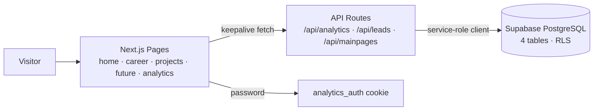

# Project Overview — AI Portfolio

What this application is, who it's for, and what it does — the entry point for the docs.

> Last Updated: 2026-02-19 · Owner: hameed · Absorbs & corrects the former root `PROJECT_DOCUMENTATION.md`

---

## What it is

A modern, interactive **developer portfolio and analytics engine** built with Next.js 16 (App
Router), React 19, Tailwind CSS v4, and Supabase. Beyond showcasing a career and projects, it
runs a **custom telemetry system** that measures how visitors actually use the site — sessions,
engagement, text selections, outbound clicks — and converts interest into **leads** with
personalized return-visit greetings. The owner reviews everything in a password-protected
analytics dashboard.

## Key features

| Area | Highlights |
| :--- | :--- |
| 💼 Career showcase | Dynamic timeline, **interactive career-map canvas with A\* pathfinding**, company deep-dive pages, tech-stack filtering |
| 🚀 Project hub | Project tiles, modal/media detail views (ImageViewer), case-study architecture, live links |
| 🔮 Future roadmap | Upcoming projects & learning trajectory page |
| ⚡ Telemetry | Sessions (device/OS/browser, geo), pageviews (stay duration, scroll depth), events (selections, outbound clicks) |
| 🎯 Lead capture | Lead modal/toast, cookie-linked identity, returning-visitor welcome toast, source attribution |
| 📊 Analytics dashboard | Password-gated session/visitor/lead/event analytics + JSON backup export |
| 🌍 i18n | English, Spanish, **Arabic with RTL** — instant client-side switching |
| 🎨 UI/UX | Light/dark theming, framer-motion route transitions, floating chatbar, custom cursor |

## Architecture in one picture

Deep dive: [System Architecture](../01-architecture/system-architecture.md).

## Tech stack

| Layer | Choice |
| :--- | :--- |
| Framework | Next.js 16 (App Router, React Compiler), React 19, TypeScript |
| Styling | Tailwind CSS v4, SCSS, Radix UI primitives (shadcn style), lucide-react |
| Animation | Framer Motion 12 — custom transition engine |
| State | Zustand (theme · language · cursor) |
| Database | Supabase PostgreSQL + RLS |
| Hosting | Vercel |

## Who uses it

- **Visitors (anonymous):** browse, get tracked (telemetry), can submit a lead.
- **The owner (admin):** views the analytics dashboard with the `ANALYTICS_PASSWORD`.

## Where to go next

- New here? → [Local Setup](../05-setup/local-setup.md), then [Feature Catalog](../02-features/feature-catalog.md)
- Contributing changes? → [System Architecture](../01-architecture/system-architecture.md) + [ADRs](../01-architecture/adr/adr-001-supabase-as-backend.md)
- Operating it? → [Deployment](../08-operations/deployment.md) + [Telemetry Guide](../06-analytics/telemetry-guide.md)
- Planning work? → [Roadmap](../09-roadmap/roadmap.md)
