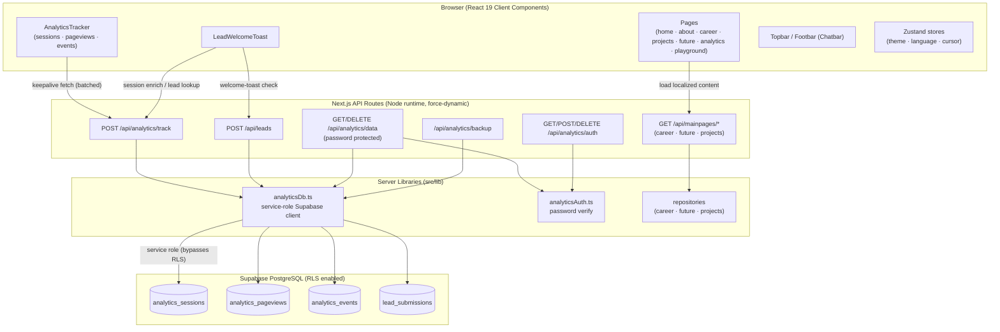
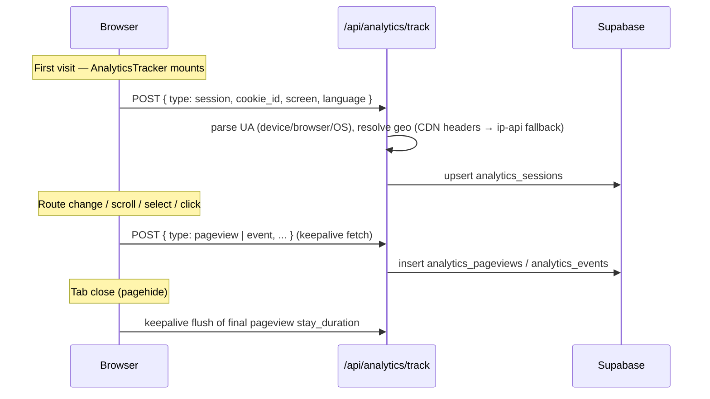
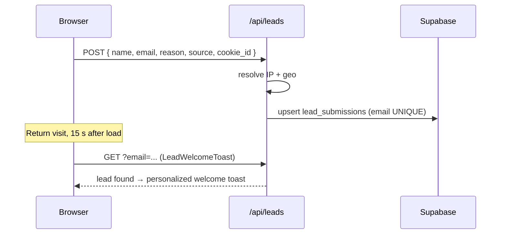

# System Architecture

One-page technical map of the AI Portfolio: components, data flow, request lifecycles, and the boundaries between client, API, and database.

> Last Updated: 2026-02-19 · Owner: hameed · Related: [ADR index](../README.md#decisions--design) · [Database Schema](../03-database/database-schema.md)

---

## 1. Bird's-Eye View



**Important nuance:** a browser-side Supabase client (`src/utils/supabase/client.ts`, publishable key)
and RLS *insert* policies exist, but the tracker **currently sends everything through the API routes**
using `fetch` with `keepalive`. All writes therefore happen server-side with the service-role key.
The anon-key path remains available for a future direct-ingestion mode (see
[ADR-002](adr/adr-002-client-side-telemetry-ingestion.md)).

## 2. Rendering Architecture

The root layout (`src/app/layout.tsx`) composes the global shell:

```
<html> → <body>
 ├── Suspense → AnalyticsTracker, LeadWelcomeToast   (non-blocking telemetry UI)
 ├── ThemeInitializer        (light/dark from localStorage)
 ├── Topbar                  (navigation, logo, theme/language controls)
 ├── page content            (route group: (client)/(mainpages)/*)
 ├── Footbar                 (Chatbar: agentbar + wings, contact/resume actions)
 ├── RouteTransitionController (framer-motion page transition overlay)
 └── AnimationTester         (dev animation sandbox)
```

- All pages are client components under the `(client)` route group; content is fetched from
  `/api/mainpages/*` per language rather than baked at build time.
- Route transitions render a full-screen overlay (bubble/strip/grid/slash variants) that plays
  during navigation — see [Feature Catalog](../02-features/feature-catalog.md).
- The career map uses an HTML canvas with an in-house A\* pathfinding engine
  (`src/features/Career/Graph/pathfinding/` — AStarEngine, HeuristicEngine, MinHeap).

## 3. Telemetry Request Lifecycle



Geo resolution strategy: prefer `x-vercel-ip-country` / `cf-ipcountry` CDN headers; fall back to
`ip-api.com` (2 s timeout); localhost resolves against the machine's public IP.

## 4. Lead Capture Lifecycle



## 5. Analytics Dashboard Flow

1. `POST /api/analytics/auth` with the admin password → sets `analytics_auth` HTTP-only cookie (7 days).
2. `GET /api/analytics/data` → `verifyAuth(req)` → aggregates sessions, pageviews, events, leads via the service-role client.
3. `GET /api/analytics/backup` exports the dataset (auth required); `DELETE /api/analytics/data` clears it.

Auth accepts: `x-analytics-auth` header, `Authorization: Bearer <password>`, or the `analytics_auth` cookie.
See [API Reference](../04-api/api-reference.md) and [ADR-003](adr/adr-003-analytics-dashboard-auth.md).

## 6. Boundaries & Trust Model

| Boundary | Mechanism | Notes |
| :--- | :--- | :--- |
| Browser → API | Public routes, no auth for tracking/leads | Intentional — anonymous visitors |
| API → DB | Service-role key, server-only | Never exposed to the client bundle |
| Dashboard → API | Shared password (cookie/header) | See ADR-003 for caveats |
| DB | RLS enabled on all 4 tables | anon can INSERT (and UPDATE for upserts) but never SELECT |

## 7. Directory Map

| Path | Role |
| :--- | :--- |
| `src/app/(client)/(mainpages)/` | Route group with all content pages |
| `src/app/api/` | 8 API routes (analytics ×4, leads, mainpages ×3) |
| `src/components/` | Global components (trackers, ImageViewer, animation engine, ui primitives) |
| `src/features/` | Page-level feature modules (Career, Projects, Future, Topbar, Chatbar, Analytics, Home, Loaders) |
| `src/lib/` | Supabase access, analytics DB layer, auth, content repositories |
| `src/utils/i18n/` | Language store + en/es/ar dictionaries |
| `src/data/` | Localized content JSON (career, projects, future) |
| `src/types/` | Shared TypeScript interfaces |
