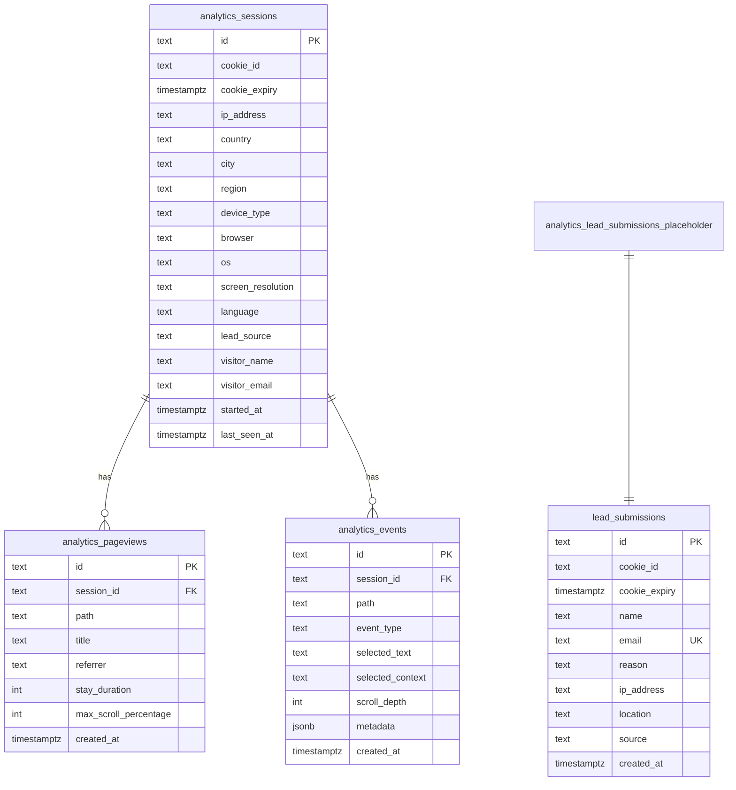

# Database Schema — Supabase PostgreSQL

> Last Updated: 2026-02-19 · Owner: hameed · Source of truth: [`database_setup.sql`](../../database_setup.sql) · Related: [ADR-001](../01-architecture/adr/adr-001-supabase-as-backend.md)

---

## Overview

Four tables back the telemetry and lead-capture systems. All use **TEXT primary keys**
(client-generated UUIDs), **timestamptz** defaults of `NOW()`, and **Row Level Security** enabled.
Pageviews and events cascade-delete with their session.

## Entity Relationship Diagram

*(The placeholder entity above is a Mermaid limitation — `lead_submissions` is standalone, linked
to sessions only logically via `cookie_id`.)*

## Tables

### `analytics_sessions` — one row per visit

Unique visitors identified by `cookie_id` (long-lived cookie). Upserted on each session start;
`visitor_name` / `visitor_email` are written back when the session is enriched by a lead.

### `analytics_pageviews` — one row per page visit

| Column | Type | Notes |
| :--- | :--- | :--- |
| `session_id` | text, FK → sessions | `ON DELETE CASCADE` |
| `stay_duration` | int, seconds | Flushed on pagehide via keepalive fetch |
| `max_scroll_percentage` | int 0–100 | Max scroll depth reached |

### `analytics_events` — one row per captured interaction

| Column | Notes |
| :--- | :--- |
| `event_type` | e.g. selection, click, outbound link |
| `selected_text` / `selected_context` | Text-selection telemetry |
| `metadata` | JSONB — extensible payload |

### `lead_submissions` — one row per lead

- `email` is **UNIQUE** — repeated submissions upsert (update name/reason/source).
- `location` is a resolved string like `City, Country`.

## RLS Policy Matrix

| Table | RLS | anon INSERT | anon UPDATE | anon SELECT | Service role |
| :--- | :-: | :-: | :-: | :-: | :--- |
| `analytics_sessions` | ✅ | ✅ | ✅ (for upsert) | ❌ | bypasses RLS |
| `analytics_pageviews` | ✅ | ✅ | — | ❌ | bypasses RLS |
| `analytics_events` | ✅ | ✅ | — | ❌ | bypasses RLS |
| `lead_submissions` | ✅ | ✅ | ✅ (for upsert) | ❌ | bypasses RLS |

> Writes today flow through API routes using the **service-role key** (see
> [ADR-002](../01-architecture/adr/adr-002-client-side-telemetry-ingestion.md)). The anon policies
> exist so a direct client-ingestion mode can be enabled without schema changes. Anon **SELECT is
> blocked everywhere** — visitors can never read analytics or lead data.

## Setup (fresh environment)

1. Open **Supabase Dashboard → SQL Editor**.
2. Paste the entire [`database_setup.sql`](../../database_setup.sql) and run it.
3. ⚠️ It first **drops** the four tables (`DROP TABLE IF EXISTS ... CASCADE`) — data loss is
   expected; it is a reset script.
4. Verify: Table Editor shows the four tables; each has RLS enabled.

## Notes & known gaps (roadmap items)

- **No secondary indexes** — dashboard queries filter by `created_at` / `session_id`; add indexes
  when data grows.
- **No retention policy** — sessions accumulate forever; consider a cleanup job or retention rule.
- **No FK from `lead_submissions.cookie_id` → sessions** — the link is logical only.
