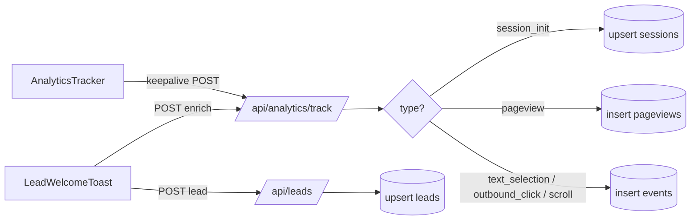

# Telemetry & Analytics Guide

How visitor tracking works end-to-end: identity model, event taxonomy, ingestion flow, and the admin dashboard.

> Last Updated: 2026-02-19 · Owner: hameed · Related: [Architecture §3](../01-architecture/system-architecture.md#3-telemetry-request-lifecycle) · [API Reference](../04-api/api-reference.md) · [ADR-002](../01-architecture/adr/adr-002-client-side-telemetry-ingestion.md)

---

## 1. What is tracked

`AnalyticsTracker` (mounted in the root layout inside `<Suspense>`) observes the visitor and
sends every payload to `POST /api/analytics/track` using **keepalive fetch** (survives tab close).

### Visitor identity

| Token | Storage | Lifetime | Purpose |
| :--- | :--- | :--- | :--- |
| `portfolio_analytics_sid` | localStorage | 1 hour (`…_sid_exp`) then regenerated | Analytics session id |
| `portfolio_lead_cookie` | browser cookie | 90 days | Ties the visitor to their lead record |

### Event taxonomy

| `type` | Trigger | Data captured |
| :--- | :--- | :--- |
| `session_init` | First payload of a session | screen resolution, language, referrer, lead source |
| `pageview` | Mount + route change + `pagehide` flush | path, title, referrer, `stayDuration`, `maxScrollPercentage` |
| `text_selection` | User selects text on the page | `selectedText`, `selectedContext` |
| `outbound_click` | Click on external links (capture phase) | link target metadata |
| `scroll` | Scroll progress on window **and** scrollable containers | `scrollDepth` % |

Scroll percentage prefers the app's scroll container (`.overflow-auto`, `main`,
`[data-scroll-container]`) and falls back to document scroll. Pages that fit without scrolling
count as 100%.

## 2. Server-side enrichment

On every call the route adds what the browser can't be trusted to provide:

- **IP** from `x-forwarded-for` → `x-real-ip` → `cf-connecting-ip` (loopback normalized to `127.0.0.1 (Localhost)`)
- **UA parsing** → device type, browser, OS
- **Geo**: Vercel/Cloudflare CDN headers first; fallback `ip-api.com` with 2 s timeout; dev fallback → `Developer Studio`

## 3. Data model recap

Sessions → pageviews/events (cascade FK). Leads upserted by email, cookie-linked to sessions.
Full column reference: [Database Schema](../03-database/database-schema.md).

## 4. The analytics dashboard (`/analytics`)

1. Password gate → `POST /api/analytics/auth` (see [ADR-003](../01-architecture/adr/adr-003-analytics-dashboard-auth.md)).
2. Reads sessions, pageviews, events, leads via `GET /api/analytics/data` (auth).
3. **Export** → `GET /api/analytics/backup` (dated JSON download).
4. **Clear all data** → `DELETE /api/analytics/data` — destructive; no confirmation server-side, be sure before clicking.
5. Lead list uses `GET /api/leads` — ⚠️ currently unauthenticated (see below).

## 5. Privacy & data governance (read this)

What you store about visitors: **IP address, city/country, device fingerprint-ish metadata,
page behavior, text selections, and (for leads) name + email + inquiry reason.**

- **Text-selection capture** is aggressive (full selected text is stored). Consider limiting
  length or disabling for sensitive pages (roadmap).
- **No consent banner** is shipped; if you operate under GDPR/CCPA you must add one or reduce
  collection (roadmap).
- ⚠️ **Known gap:** `GET /api/leads` exposes all lead PII without auth — fix prioritized in the
  [Roadmap](../09-roadmap/roadmap.md).
- **No retention policy**: rows accumulate forever; schedule periodic cleanup or a Supabase
  retention function (roadmap).
- The admin password defaults to `admin123` when `ANALYTICS_PASSWORD` is unset — always set it.

## 6. Troubleshooting

| Symptom | Fix |
| :--- | :--- |
| No telemetry rows | Check function logs for `[Supabase Analytics]` errors; verify env vars |
| `stayDuration` always 0 | `pagehide` flush didn't fire — some browsers throttle keepalive; check `navigator.sendBeacon` alternative (roadmap) |
| Geo = "Developer Studio" | Expected in local dev or when ip-api times out |
| Dashboard shows stale data | Routes are `force-dynamic`; hard-refresh the browser |
